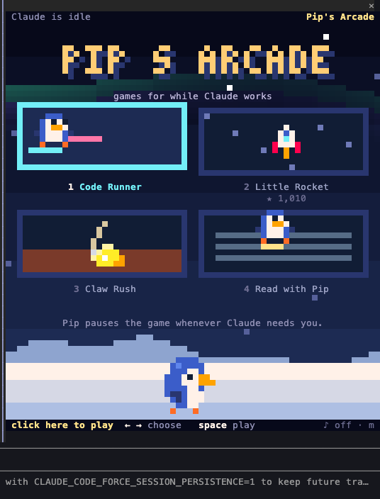
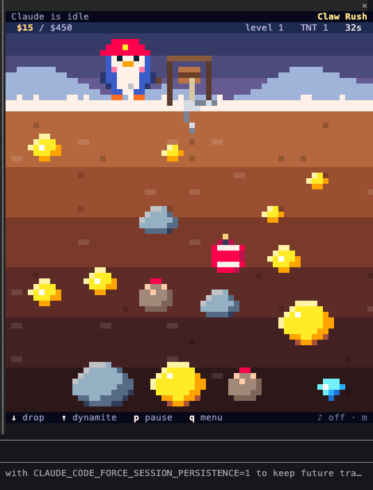
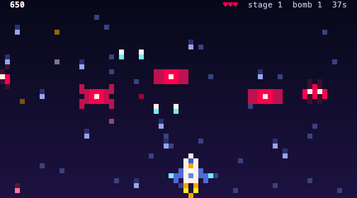
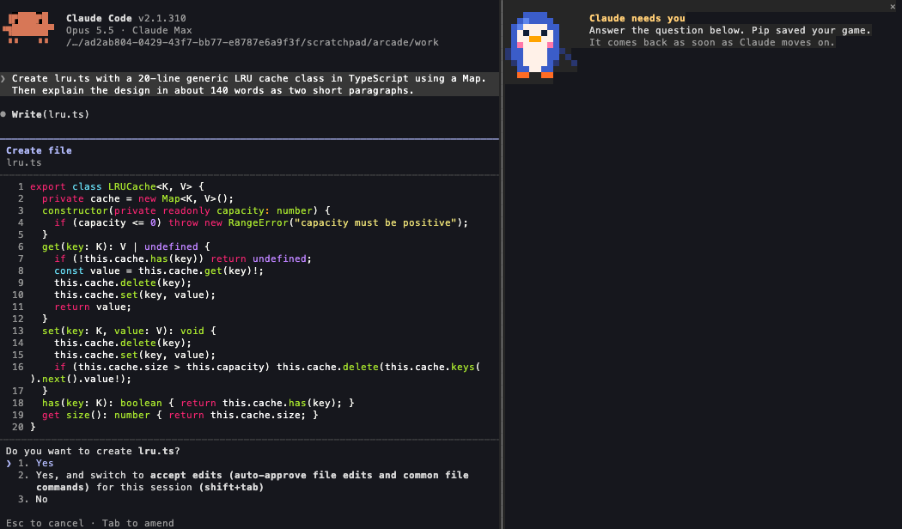

# Pip's Arcade

Pip is a little blue penguin who lives in your Claude Code terminal. Three tiny games fill the wait while Claude works, and they freeze the moment Claude needs your answer. When Claude is done, Pip reads the answer with you, walking across it one word at a time.

<p>
  
  
  
</p>

| Game | What it is |
|---|---|
| **Code Runner** (代码跑酷) | Pip runs across the code Claude is writing. Each line becomes a platform with the real text on it, indentation sets its height, blank lines open gaps, and the words under Pip's feet light up. New code types itself in ahead of you. |
| **Little Rocket** (小火箭) | Galaga's shape with auto-fire. Waves of bugs fly into formation and dive, fish power you up, and the Heisenbug waits at the end of the stage. |
| **Claw Rush** (抓金子) | The rules of the 4399 Flash classic with our own art. Swing the claw, drop it, reel in the gold. Heavy things reel in slowly, TNT takes out everything near it, and a trading post sits between levels. |
| **Read with Pip** (跟读) | Drawn over Claude's own reply in the transcript. Only the word under Pip's feet lights up and the whole answer stays on screen. ↑ ↓ change the pace, ← → step back or ahead, space pauses, a click moves Pip to that word. |

## Claude comes first

- After Claude has worked for 15 seconds, one line above the prompt offers a game. `/pip off` hides it.
- The top row of the arcade says what Claude is doing (writing `lru.ts`, running tests) and for how long.
- When Claude asks you something, the game leaves the pane at once, so every key reaches the question. Your round is saved, and it comes back with "Welcome back" when Claude moves on.
- When Claude finishes a long answer, one line above the prompt offers to read it with Pip.



## Install

Try it for one session:

```bash
claude --plugin-dir ~/linewalker
```

Keep it:

```bash
claude plugin marketplace add ~/linewalker
claude plugin install linewalker@pip-arcade
```

Then, at the Claude Code prompt:

| Type | What happens |
|---|---|
| `/pip` | Opens the arcade. Click the game once and the arrows, space and letters reach it. |
| `/pip runner`, `/pip rocket`, `/pip claw` | Starts that game, even while Claude works. |
| `/pip read` | Pip reads Claude's last answer with you, in the transcript. |
| `/pip off`, `/pip on` | Stops or restarts Pip's offers above the prompt. |
| `/pip sound`, `/pip calm` | Turns sound on or off; turns screen shake and flashes off. |

Requirements and limits:

- Claude Code 2.1.287 or later, in a terminal. The VS Code chat panel can't draw the games yet.
- Clicking a game to give it the keyboard needs the fullscreen renderer (`/tui fullscreen`). In the classic renderer, the keys printed under the game drive it.
- Inside tmux, Claude Code draws 256 colours, so the art looks flatter.

## How it works

- `hooks/register.js` is the hooks module: the `/pip` command, the pane, the offers above the prompt, scores and sound. It follows Claude through `turn.start`, `tool.call`, `tool.check` (an `ask` decision means Claude needs you) and `turn.complete`, and it rewrites the `AssistantMessage` site to draw the reader over the reply.
- `client/arcade.js` and `client/reader.js` are surface modules (`Client` elements). They run on the drawing surface with their own 30 fps clock and keyboard, so nothing round-trips per frame.
- `client/lib/gfx.js` draws pixels as `▀` half blocks (two pixels per cell) with a separate layer of real characters for anything people read, and merges cells into runs so a frame stays a few hundred elements.
- `client/lib/juice.js` holds the effects. Every effect has a tier and returns to rest: hit-stop of 1 to 4 frames, directional shake of 1 to 3 pixels, particles that live under half a second.
- The game rules in `client/games/` are plain functions over plain data, so a round can be posted to the hooks module and restored after an approval pause.
- `sfx/` is synthesized by `dev/make-sfx.mjs`; nothing is borrowed.

## Develop

```bash
claude plugin validate .
claude plugin test .
node dev/make-sfx.mjs
python3 -m http.server 8765   # then open dev/harness.html?m=../client/arcade.js
```

`dev/harness.html` runs the surface modules in a browser against a stand-in for Claude Code's surface, which is the quickest way to work on the art.

## Credits

Game rules come from public descriptions of Galaga and Gold Miner and from endless runners in general, and game rules are not protected; all art, names and sounds are our own. Game-feel numbers follow the `game-feel` and `agentic-gamedev-skills` agent skills, Celeste's released player code and the "Juice it or lose it" demo.

MIT licence.
