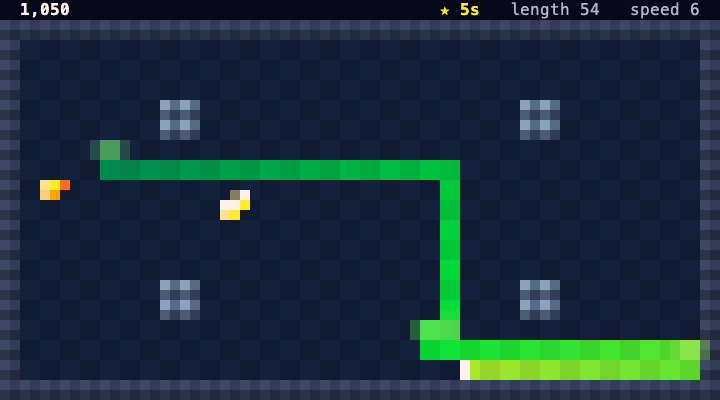
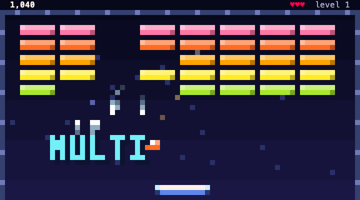

# OG's Arcade

Four classic games in your Claude Code terminal, for while Claude works: **Snake**, **Brick Break**, **Little Rocket** and **Claw Rush**, hosted by Pip the penguin. A game freezes the moment Claude needs you. Everyone plays the same levels all week, and the best players end up right here.

<!-- board:start -->
### This week: week 44, ends Monday 00:00 UTC

| # | Player | Points | Snake | Brick Break | Little Rocket | Claw Rush |
|--:|:--|--:|--:|--:|--:|--:|
| 1 |  [@playmoresports](https://github.com/playmoresports) | **25** | · | 270 🥇 | · | · |

<sub>Updated 2026-10-26 04:41 UTC by the board's GitHub Action. Points per game: 25, 18, 15, 12, 10, 8, 6, 4, 2, 1 for the top ten.</sub>
<!-- board:end -->


<p>
  
  
  
</p>

## Install

```bash
claude plugin marketplace add IndusCore-AI/og-arcade
claude plugin install og-arcade@og-arcade
```

Then type `/og` in Claude Code and click the game once, so the arrow keys reach it.

## The games

| Game | What it is |
|---|---|
| **Snake** (贪吃蛇) | The Nokia classic. Eat fish, grow, don't bite your tail. A golden fish shows up every fifth fish for a few seconds, and each week has its own maze. |
| **Brick Break** (打砖块) | The bouncing ball and the wall of bricks, like the iPod's Brick. Catch capsules for multi-ball, a wider paddle, a slower ball or a fireball. Chain bricks without touching the paddle for up to x8. |
| **Little Rocket** (小火箭) | Galaga's shape with auto-fire. Waves of bugs fly into formation and dive, fish power you up, and the Heisenbug waits at the end of every stage. |
| **Claw Rush** (抓金子) | The rules of the 4399 Gold Miner, with our own art. Swing the claw, drop it, reel in gold. Heavy things reel slowly, TNT takes out everything near it, and a trading post sits between levels. |

## The weekly board

- **Same levels for everyone.** The week picks every game's levels, so all week everyone gets the same maze, brick layouts, waves and gold. They change every Monday at 00:00 UTC.
- **Post your best.** When you finish a game with your best score of the week, press **b** on the game-over screen. That posts the run as an issue on this repo under your GitHub name. It needs the [GitHub CLI](https://cli.github.com), logged in with `gh auth login`.
- **Only real runs count.** A run is the list of keys you pressed. A GitHub Action plays them back through the same game code, and the score goes on the board only if it comes out exactly the same. Editing the game or typing in a score gets you nothing.
- **Points decide the OG.** Each game ranks its players, and the top ten get 25, 18, 15, 12, 10, 8, 6, 4, 2 and 1 points. Whoever has the most points across all four games is the OG of the week. On Monday their name and picture go at the top of this page.

## Claude comes first

- After Claude has worked for 15 seconds, one line above the prompt offers a game. `/og off` hides it.
- The arcade's top row says what Claude is doing (writing `lru.ts`, running tests) and for how long.
- When Claude asks you something, the game leaves the pane at once, so every key reaches the question. Your run is saved and comes back with "Welcome back" when Claude moves on.


## Commands

| Type | What happens |
|---|---|
| `/og` | Opens the arcade. Click it once and the arrows, space and letters reach it. |
| `/og snake`, `/og brick`, `/og rocket`, `/og claw` | Starts that game, even while Claude works. |
| `/og board` | Shows this week's board. |
| `/og post` | Posts your unposted bests of the week. |
| `/og off`, `/og on` | Stops or restarts the offer above the prompt. |
| `/og sound`, `/og calm` | Turns sound on or off; turns screen shake and flashes off. |

Requirements and limits:

- Claude Code 2.1.287 or later, in a terminal. The VS Code chat panel can't draw the games yet.
- The pane needs 72 × 22 cells, because every game plays on the same fixed screen.
- Clicking a game to give it the keyboard needs the fullscreen renderer (`/tui fullscreen`). In the classic renderer, the keys printed under the game drive it.
- Inside tmux, Claude Code draws 256 colours, so the art looks flatter.

## How it works

- `hooks/register.js` is the hooks module: the `/og` command, the pane, the offer above the prompt, scores, sound, your best runs of the week and posting them with `gh`. It follows Claude through `turn.start`, `tool.call`, `tool.check` (an `ask` decision means Claude needs you) and `turn.complete`.
- `client/arcade.js` is a surface module (a `Client` element) with its own 30 fps clock and keyboard, so nothing round-trips per frame.
- `client/sim.js` runs a game one update at a time from a week's seed and the keys pressed. The arcade plays through it and the board's verifier replays through it.
- `client/lib/det.js` has sin, cos and atan2 built from plain arithmetic. The board replays runs on Node, while Claude Code runs Bun, and the built-in versions may differ in the last bit between engines. The games' rules use only these, the world's own seeded random numbers, and a fixed 72 × 40 pixel screen.
- `client/lib/gfx.js` draws pixels as `▀` half blocks (two pixels per cell) with a separate layer of real characters for anything people read. `client/lib/juice.js` holds the effects: hit-stop of 1 to 4 frames, a springy shake of 1 to 3 pixels, particles that live under half a second.
- `scripts/board/board.mjs` is the board: `verify`, `apply`, `respond` and `crown`, run by `.github/workflows/board.yml` and `crown.yml`.

## Running the board

- When a change to a game would make an old run play out differently, bump `RULES` in `client/sim.js` and regenerate the fixtures in `tests/`. Players then see "update with `claude plugin marketplace update og-arcade`" on old runs.
- The week closes by itself on Monday at 00:05 UTC. To close one by hand, run `gh workflow run crown`.
- To take a run off the board, delete it from `board/state.json`, run `node scripts/board/board.mjs render`, and commit.

## Develop

```bash
claude plugin validate .
claude plugin test .
node dev/make-sfx.mjs
python3 -m http.server 8765   # then open dev/harness.html?m=../client/arcade.js
```

`dev/harness.html` runs the surface modules in a browser against a stand-in for Claude Code's surface. `?m=./solo.js&props={"game":"snake"}&cols=72&rows=20` runs one game on its own.

## Credits

The game rules come from public descriptions of Snake, Breakout, Galaga and Gold Miner, and game rules can't be owned. All art, names and sounds are our own. The game-feel numbers follow the `game-feel` and `agentic-gamedev-skills` agent skills, Celeste's released player code and the "Juice it or lose it" demo.

MIT licence.
